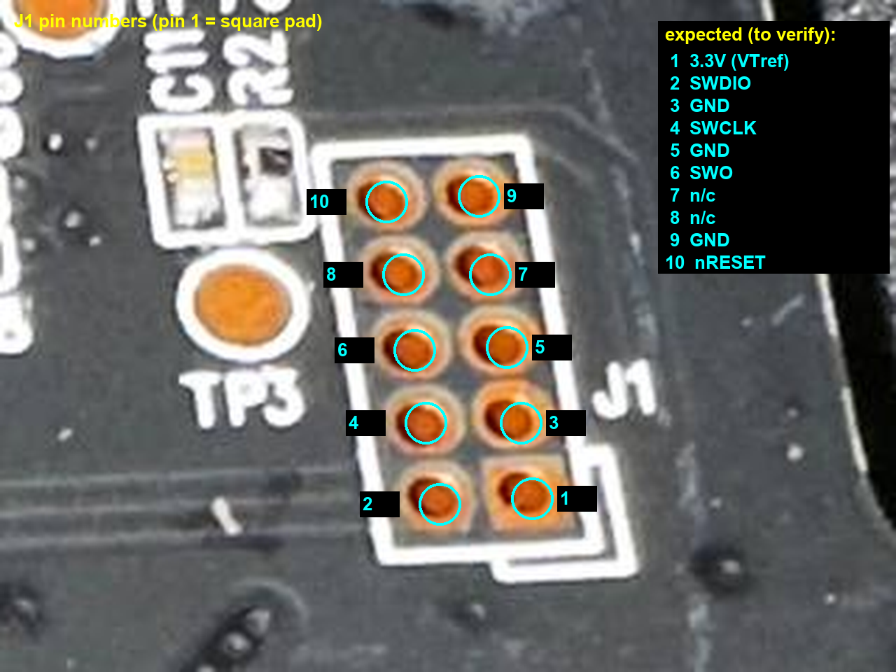
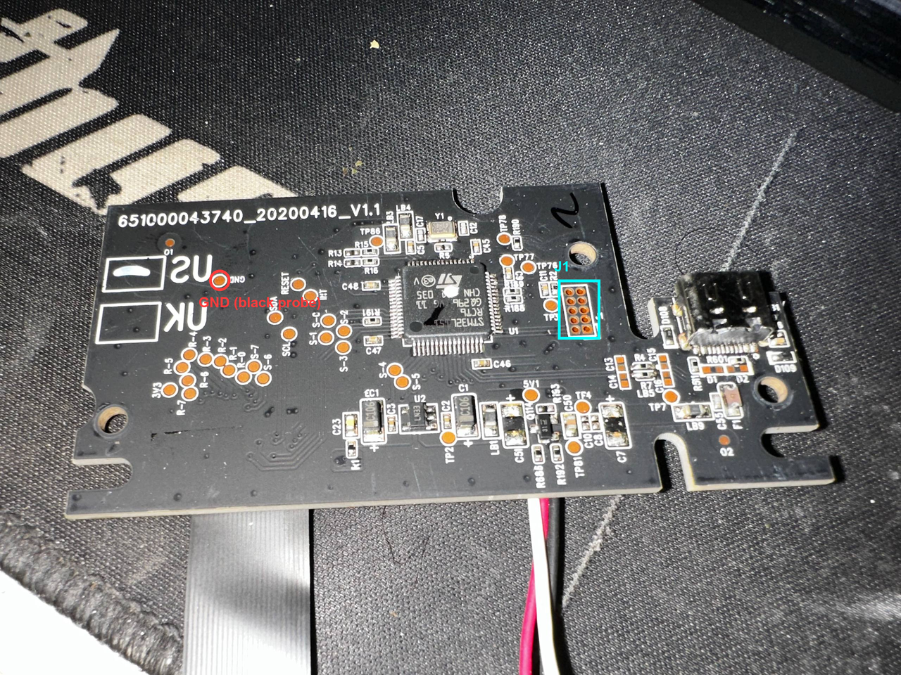

# qmk-razer

[QMK](https://qmk.fm) (with [VIA](https://usevia.app)) for Razer keyboards, starting with the **Razer Huntsman Mini**.

| Keyboard | MCU | Status |
|---|---|---|
| Razer Huntsman Mini (RZ03-0339) | STM32L151RCT6 | **Working**: QMK + VIA, optical switch scanning, per-key RGB (IS31FL3733), USB DFU updates. Full 61-key test pending |
| Razer Huntsman V3 Pro Mini (RZ03-0499) | ? | Not started |

> [!WARNING]
> This replaces Razer's firmware, needs the case opened for the first install, and voids your warranty.
> Razer's own bootloader cannot be kept (see below), so going back to stock means restoring your own SWD backup.
> You do this at your own risk. Not affiliated with or endorsed by Razer.

> [!CAUTION]
> **Never send the Razer bootloader read command (`0x10/0x83`) outside an update.** On the Huntsman Mini it made the
> bootloader erase its own vector table: the board stopped booting and no longer showed up on USB at all.
> Recovery needed SWD. Details in [`huntsman-mini/NOTES.md`](huntsman-mini/NOTES.md).

## Razer Huntsman Mini

### Hardware

| | |
|---|---|
| MCU | STM32L151RCT6 (Cortex-M3, 256 KB flash, 32 KB RAM, 8 KB data EEPROM), 12 MHz crystal |
| Switch matrix | 8×8, optical. Rows PB0 PB1 PB10–PB15 (drive LOW), columns PC6–PC9 PA8 PA9 PA10 PA15 (LOW = pressed) |
| RGB | IS31FL3733 at I2C `0x50` on I2C1 (PB6 SCL / PB7 SDA), SDB on PC13, 63 LEDs |
| Debug | Unpopulated `J1` on the I/O board: ARM 10-pin 1.27 mm SWD (pin 2 SWDIO, 4 SWCLK, 3/5/9 GND, 10 nRESET) |
| Stock layout | Razer bootloader `0x08000000`–`0x08003FFF` (USB `1532:110E`), app from `0x08004000` |




Full reverse-engineering notes: [`huntsman-mini/NOTES.md`](huntsman-mini/NOTES.md),
[`docs/stock_firmware_re.md`](huntsman-mini/docs/stock_firmware_re.md) (pins, scan timing, LED driver, clocks) and
[`docs/razer_bootloader_protocol.md`](huntsman-mini/docs/razer_bootloader_protocol.md) (Razer updater protocol).

### First install (SWD)

You need an SWD probe. A Raspberry Pi Pico (or Pico 2) running Raspberry Pi's
[debugprobe](https://github.com/raspberrypi/debugprobe/releases) firmware works, together with
[OpenOCD](https://openocd.org) 0.12.

1. Open the keyboard and solder (or hold) wires on `J1`:

   | J1 pin | Signal | Pico pin |
   |---|---|---|
   | 4 | SWCLK | 4 (GP2) |
   | 2 | SWDIO | 5 (GP3) |
   | 3 | GND | 3 (GND) |
   | 10 | nRESET (optional) | 2 (GP1) |

   Leave J1 pin 1 (3.3 V) unconnected and power the keyboard from its own USB cable.
2. Check the connection and protection level (read-only):
   `openocd -f swd/huntsman_mini.cfg -f swd/probe_readonly.tcl`
   (on the unit this port was made on, readout protection was level 0).
3. **Back up the stock firmware and settings** (read-only):
   `openocd -f swd/huntsman_mini.cfg -f swd/dump_all.tcl`. Keep the files in `huntsman-mini/dumps/` safe; they are
   the only way back to stock. They are not in this repository because they contain Razer's firmware.
4. Flash QMK (backs up again, then writes and verifies):
   `openocd -f swd/huntsman_mini.cfg -c "set FW <path>/razer_huntsman_mini_via.bin" -f swd/flash_qmk.tcl`

If the first boot after a flash doesn't show up on USB, replug once.

### Updating (USB, no case opening)

QMK starts the STM32 factory USB DFU bootloader (`0483:DF11`, "STM32 BOOTLOADER"):

* press **Fn + `\`** (`QK_BOOT`), or
* hold **Esc** while plugging the keyboard in (Bootmagic, also clears the EEPROM).

Then flash the `.bin` with [QMK Toolbox](https://github.com/qmk/qmk_toolbox) (it installs the DFU driver), or
`dfu-util -a 0 -d 0483:df11 -s 0x08000000:leave -D razer_huntsman_mini_via.bin`.

If a build ever can't reach `QK_BOOT`/Bootmagic, recover over SWD as in the first install.

### Building

The keyboard lives in [`huntsman-mini/qmk/keyboards/razer/huntsman_mini`](huntsman-mini/qmk/keyboards/razer/huntsman_mini).
Copy it into a [QMK checkout](https://docs.qmk.fm/newbs_getting_started) as `keyboards/razer/huntsman_mini`, then:

```sh
qmk compile -kb razer/huntsman_mini -km via      # or -km default
```

`keyboard.json`, `led_map.h` and the VIA definition are generated from one table by
[`huntsman-mini/qmk/gen_keyboard.py`](huntsman-mini/qmk/gen_keyboard.py): edit the table there, not the outputs.
[`tools/remote_build.ps1`](tools/remote_build.ps1) does the copy + compile + fetch on a remote Linux build host.

Port specifics worth knowing (all in the keyboard directory):

* No QMK MCU preset for the STM32L151: custom board files, `mcuconf.h` and linker script.
* **Flash prefetch is disabled** after clock init. With ChibiOS' default (prefetch on) the first instruction fetch
  after waking from `WFI` was corrupted and the board hard-faulted; the stock firmware also runs without prefetch.
* Custom optical matrix scan that copies the stock timing: 125 µs row settle, columns precharged HIGH, pull-ups only
  on released keys (hysteresis), 12 µs sample window.
* Data EEPROM writes stall the CPU (~3 ms each), so settings are initialised before USB starts.
* USB ID `5248:0257` (VIA rejects QMK's placeholder `FEED`; Razer's own `1532` would attach Razer's drivers).

### VIA

VIA doesn't know this keyboard, so load the definition once: VIA → Settings → **Show Design tab** → Design →
**Load Draft Definition** →
[`huntsman-mini/qmk/via/razer_huntsman_mini.json`](huntsman-mini/qmk/via/razer_huntsman_mini.json).

### Going back to stock

Restore your own backup over SWD (flash `swd_flash_08000000_256K.bin` to `0x08000000` and the EEPROM dump to
`0x08080000`). If the Razer bootloader was already damaged, write the stock app's vector table to `0x08000000`
so the app boots directly (see the recovery section in [`NOTES.md`](huntsman-mini/NOTES.md)). Razer's updater won't
work without its bootloader.

## Repository layout

```
huntsman-mini/
  NOTES.md                 findings, incident log, port status
  docs/                    stock firmware + Razer bootloader protocol write-ups
  photos/                  I/O board photos, J1 pinout
  qmk/                     QMK keyboard, generator, VIA definition
  re/                      analysis scripts (Ghidra/capstone); outputs are not committed
swd/                       OpenOCD config and scripts (probe, backup, flash, tests)
tools/                     Razer updater extraction, Razer HID tool, remote build, USB watcher
```

Not included on purpose: Razer's updaters, firmware, flash dumps and decompiled code. The scripts in
`tools/` and `huntsman-mini/re/` can recreate the analysis from Razer's official updater.

## License

GPL-2.0-or-later (see [LICENSE](LICENSE)), matching QMK. Parts of the board support files are adapted from
[ChibiOS](https://www.chibios.org) (Apache License 2.0) and QMK. "Razer" and "Huntsman" are trademarks of Razer Inc.
